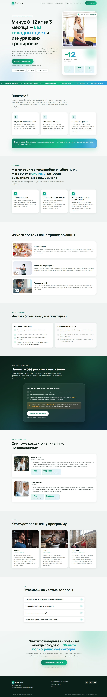

> [← Портфолио Марины Петрушиной](https://mary-rnd.github.io/portfolio/) — сайты, ИИ-боты, трекеры и автоматизация для малого бизнеса и MedTech.

# sport-land-landing

**Рекламный лендинг фитнес-программы «Спорт-ленд»** — самостоятельный
маркетинговый проект: сбор заявок через продающую структуру, светлая
эмеральд-палитра, адаптивная вёрстка и чистый HTML/CSS/JS без фреймворков
и сборщиков.



**Live demo:** [mary-rnd.github.io/sport-land-landing](https://mary-rnd.github.io/sport-land-landing/) — деплой на GitHub Pages.

---

## О проекте

Страница построена по классической рекламной схеме прогрева:

```
Герой с оффером + карточка результата
   -->
Боли ЦА (знакомо?)
   -->
Подход / преимущества
   -->
Программа на 12 недель
   -->
Фильтр «есть / нет»
   -->
Оффер + форма (модалка)
   -->
Кейсы до/после
   -->
Команда
   -->
FAQ
   -->
Финальный CTA
```

## Возможности

- Модальная форма «Имя + телефон + email» с валидацией и маской телефона.
- AJAX-отправка заявки на **FormSubmit** (без своего бэкенда).
- FAQ-аккордеон и бургер-меню.
- Reveal-анимации появления блоков (IntersectionObserver).
- Счётчики результатов с анимацией при скролле.
- Полностью адаптивная вёрстка (mobile / tablet / desktop).
- Логотип-SVG в favicon, Google Fonts **Manrope**.

## Стек

| | |
|---|---|
| Разметка | HTML5 (семантические секции) |
| Стили | CSS3: custom properties, grid, flexbox, градиенты |
| Логика | JavaScript (vanilla): модалка, валидация, аккордеон, reveal |
| Форма | FormSubmit — приём заявок на email |
| Деплой | Статический хостинг (Cloudflare Pages / Workers, Netlify Drop) |

## Запуск

```bash
# локальный просмотр
python -m http.server 8000
# http://localhost:8000/
```

Для деплоя достаточно выложить содержимое папки на любой статический
хостинг (Cloudflare Pages → Upload assets → перетащить папку).

## Структура

```
.
├─ index.html                 # разметка всех секций
├─ styles.css                 # дизайн-система и адаптив
├─ script.js                  # интерактив и отправка формы
├─ images/                    # фото (hero, кейсы, команда, шаги)
├─ screenshots/
│  ├─ desktop-full.jpg        # полная версия (desktop, 1440)
│  ├─ desktop-hero.png        # секция hero
│  ├─ desktop-form.png        # форма регистрации
│  └─ mobile-hero.png         # мобильный hero (390)
├─ README.md
└─ LICENSE                    # MIT
```

## Лицензия

MIT — см. `LICENSE`.

